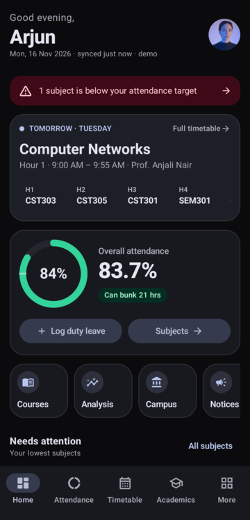
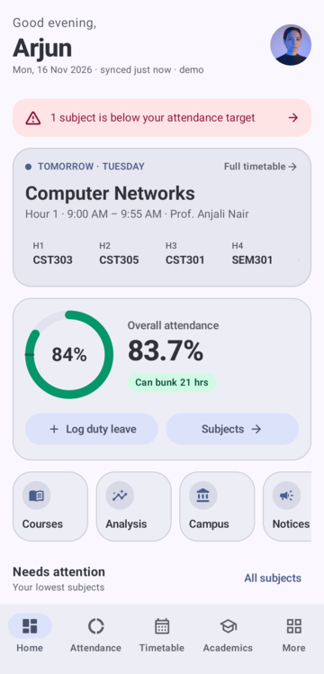
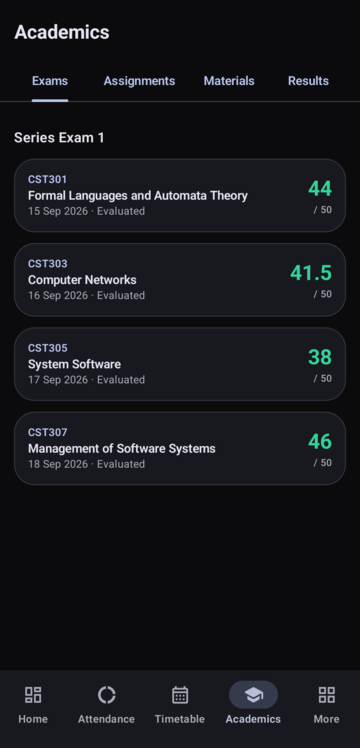
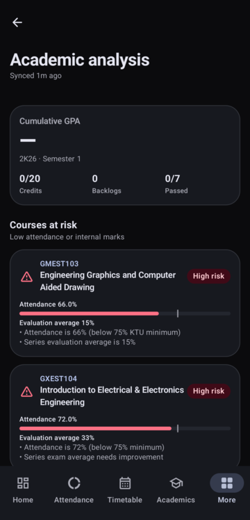
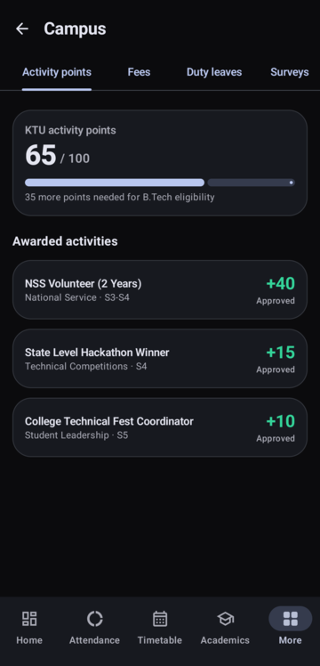
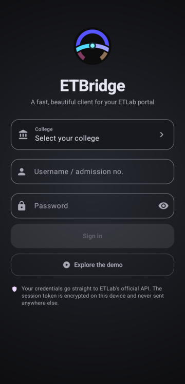

<p align="center">
  
</p>

<h1 align="center">ETBridge for Android</h1>

<p align="center">
  A fast, native Android client for the ETLab student portal — attendance with bunk-margin maths,
  live timetable, marks, assignments and more, built with Kotlin and Jetpack Compose.
</p>

<p align="center">
  <a href="https://github.com/ET-Bridge/android/releases/latest"><b>⬇ Download the latest APK</b></a>
  ·
  <a href="https://etbridge.nimd.me">Web app</a>
  ·
  <a href="https://github.com/nimdme/et-bridge">Web app source</a>
</p>

<p align="center">
  
  
  
</p>
<p align="center">
  
  
  
</p>
<p align="center"><sub>Screenshots use the built-in demo account; all names are fictional.</sub></p>

---

## Contents

- [Features](#features)
- [Install](#install)
- [Updating](#updating)
- [Privacy & security](#privacy--security)
- [Building from source](#building-from-source)
- [Project structure](#project-structure)
- [Release signing](#release-signing)
- [Performance tooling](#performance-tooling)
- [Contributing](#contributing)
- [License & disclaimer](#license--disclaimer)

## Features

**Attendance**
- Per-subject attendance with an animated ring, and the exact number of hours you can **bunk** or must
  **attend** to stay above your target (75% by default, adjustable in Settings)
- *What if…* slider: see your percentage if you skip or attend the next N hours
- Calendar view of every day's attendance, and per-subject class history (absent / present / duty
  leave) with the topics covered in each class
- **Duty leave projection**: log approved duty leaves hour by hour and see projected attendance
  immediately; ETBridge marks them official once ETLab records them. Logged leaves stay on your phone
  only — they are never sent to ETLab or your college.

**Daily use**
- Live "happening now / up next" class card with a progress bar through the current period
- Week strip + swipeable day-by-day timetable with substitutions, special classes and holidays
- Upcoming series exams, published marks with the class average, assignments (open / submitted /
  marked) with attachment download and online submission where your college allows it
- Study materials, university results, faculty directory (call / email), courses with syllabus
  coverage, academic analysis (CGPA, SGPA trend, courses at risk), KTU activity points, fees, surveys,
  notices and circulars

**Native extras**
- Home-screen widgets: *Next class* and *Attendance overview*
- Background sync every 4 hours, with optional notifications when a subject drops below your target,
  when new notices/marks appear, and 10 minutes before each class
- Optional **app lock** (fingerprint, face or screen lock); on Android 13+ app content is also hidden in the recents screen
- Material You colours that follow your wallpaper, plus dark/light themes
- Works offline from the last sync; demo mode to try everything without an account

## Install

ETBridge is distributed as an APK on the [Releases page](https://github.com/ET-Bridge/android/releases).
It needs **Android 8.0 or newer**.

1. On your phone, open the [latest release](https://github.com/ET-Bridge/android/releases/latest) and
   download `ETBridge-vX.Y.Z.apk`.
2. Open the downloaded file. Android will ask you to allow installs from your browser or file manager
   ("Install unknown apps") — allow it for that app only.
3. Tap **Install**, then open ETBridge, pick your college and sign in with your ETLab username and
   password — or tap **Explore the demo**.

> **Verify the download (optional).** Each release lists the APK's SHA-256 checksum and the signing
> certificate fingerprint. On a computer: `sha256sum ETBridge-vX.Y.Z.apk`, and
> `apksigner verify --print-certs ETBridge-vX.Y.Z.apk` should show the certificate SHA-256 digest
> `30:57:B1:31:90:59:14:91:F4:5E:50:47:9F:B2:29:D0:43:E1:59:EA:0E:F7:B1:DA:FC:AD:35:49:FB:38:4B:D9`.

## Updating

Download the newer APK from Releases and install it over the existing app — your login and data are
kept. Every official release is signed with the same key, so Android accepts it as an update.

If Android says the app *conflicts with an existing package*, the installed copy was signed with a
different key (for example a build you made yourself). Uninstall it first; note that this deletes
locally logged duty leaves.

## Privacy & security

- **No ETBridge server.** The app talks directly to ETLab's official student API
  (`api.students.etlab.app`). Your credentials and data never pass through anyone else.
- Your session token is encrypted with an AES-256 key held in the **Android Keystore**; cached ETLab
  data lives in the app's private storage so the app works offline.
- App backups are disabled, so nothing is copied to cloud backups. **Signing out deletes** the
  session, the cache and logged duty leaves.
- Feedback you choose to send (from *More → Something missing or wrong?*) is delivered through
  Web3Forms along with your institute code and username so problems can be reproduced.

## Building from source

Requirements: the Android SDK (platform 37, build-tools) and an internet connection. You don't need
a local JDK with `javac` — Gradle downloads JDK 21 for itself via the Foojay toolchain resolver.

```bash
git clone https://github.com/ET-Bridge/android.git
cd android
echo "sdk.dir=$HOME/Android/Sdk" > local.properties   # path to your Android SDK

./gradlew :app:assembleDebug      # debug APK  → app/build/outputs/apk/debug/
./gradlew :app:assembleRelease    # release APK (minified) → app/build/outputs/apk/release/
./gradlew :app:bundleRelease      # Play Store bundle → app/build/outputs/bundle/release/
./gradlew test                    # unit tests (attendance maths, parsers, reconciliation…)
./gradlew :app:installDebug       # install on a connected device
```

Without a `keystore.properties` file, release builds are signed with the debug key, so anyone can
build and test them (see [Release signing](#release-signing)).

`core/model` contains an opt-in test that decodes real ETLab responses. Save responses as
`<endpoint>.json` in a private folder (never commit them — they contain personal data) and run
`ETLAB_FIXTURES=/path/to/folder ./gradlew :core:model:test`.

## Project structure

| Module | Contents |
|---|---|
| `core/model` | Lenient kotlinx.serialization models of ETLab payloads and formatting helpers |
| `core/domain` | Pure-Kotlin logic: bunk-margin maths, duty-leave projection and reconciliation, schedule, subject history |
| `core/data` | Ktor/OkHttp API client, Room cache (stale-while-revalidate, 4 h), encrypted session, demo data, downloads/uploads |
| `core/designsystem` | Theme (Material You + brand fallback), motion specs and shared components |
| `app` | Screens, navigation, widgets (Glance), background sync and notifications (WorkManager), app lock |
| `baselineprofile` | Baseline Profile generator and Macrobenchmark startup/scroll benchmarks |

Tech: Kotlin 2.4, Jetpack Compose (Material 3), Hilt, Ktor, Room, DataStore + Tink, WorkManager,
Glance, Coil 3. `minSdk 26`, `targetSdk 36`.

The attendance maths matches the web app:

```
can miss    = ⌊ P / t − T ⌋              (when P / T ≥ t)
must attend = ⌈ (t·T − P) / (1 − t) ⌉    (when P / T < t)
P = hours present, T = hours conducted, t = target (0.75 by default)
```

## Release signing

Official releases are signed with the project's release key. Signing settings are read from
`keystore.properties` in the project root (git-ignored); copy `keystore.properties.example` and fill
in your keystore path and passwords. **Never commit the keystore or its passwords**, and keep a
backup: without the original key, no future release can install over existing copies.

To publish a new version:

1. Bump `versionCode` (must increase every release) and `versionName` in `app/build.gradle.kts`.
2. Add the changes to `CHANGELOG.md`.
3. `./gradlew test :app:assembleRelease`
4. Create a GitHub release tagged `vX.Y.Z` and attach the APK renamed to `ETBridge-vX.Y.Z.apk`
   together with its SHA-256 checksum.

## Performance tooling

`baselineprofile` holds a demo-mode user journey shared by:

- `BaselineProfileGenerator` — `./gradlew :app:generateBaselineProfile`
- `StartupBenchmark` / `ScrollBenchmark` — `./gradlew :baselineprofile:connectedBenchmarkReleaseAndroidTest`

These builds install as a separate package (`me.nimd.etbridge.bench`), so they never replace or wipe
a real install on the device. Known limitation: Android 17 (API 37) builds currently record no runtime
profile and lack the tracing Macrobenchmark needs — use an API 33–36 device or emulator.

## Contributing

Bug reports and pull requests are welcome. Please don't attach screenshots or logs that show real
student data; demo mode reproduces most screens.

## License & disclaimer

Released under the [MIT License](LICENSE).

ETBridge is an independent, community-built open-source project. It is **not affiliated with,
endorsed by or connected to ETLab or Etuwa Concepts**. All product names and trademarks belong to
their respective owners.
